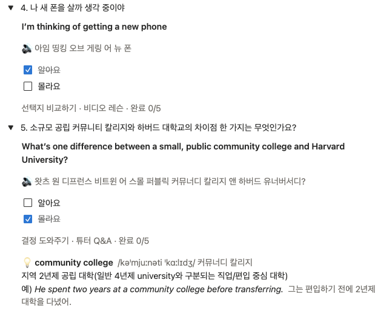
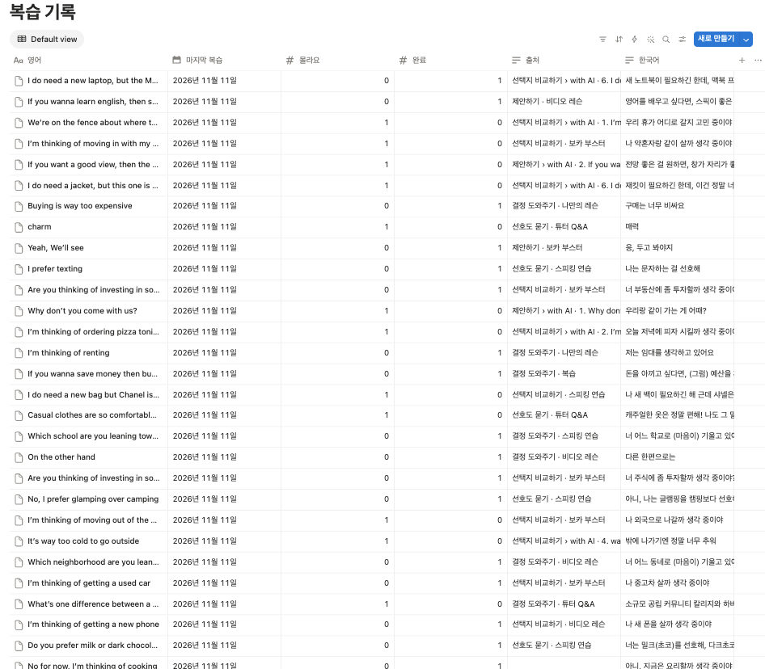

# daily-recall

Speak 앱으로 공부한 영어 문장을 노션에 정리해 두면, **매일 새벽 그중 30문장을 골라 "오늘의 복습" 페이지를 만들어 주는** 개인용 복습 도구입니다.
서버 없이 **GitHub Actions + 노션 API + Gemini 무료 API**만으로 돌아가서 비용이 들지 않습니다.



## 왜 만들었나

- 공부한 문장을 노션에 정리만 하고 다시 보지 않으면 며칠 안에 잊어버립니다.
- 오래 기억하려면 **다시 읽기보다 떠올리기(인출 연습)** 가 효과적이고, **아는 건 덜, 모르는 건 더 자주** 봐야 합니다.
- Anki 같은 앱은 카드를 따로 만들어야 해서 금방 지칩니다. 이 도구는 **평소 쓰던 노션 정리가 그대로 복습 재료**가 됩니다.

## 어떻게 동작하나

```
[노션] 학습 페이지들 (SOURCE_PAGE_IDS)            [노션] 복습 페이지 (REVIEW_PAGE_ID)
  Speak › 중급 1                                    ├ 📝 오늘의 복습 2026-11-14   ← 매일 하나씩 생김
  Speak › take 구동사 (1탄)  …계속 추가 가능         ├ 📝 오늘의 복습 2026-11-13 ✅ ← 반영 끝난 날
         │                                          └ 🗂 복습 기록 (DB)           ← 문장별 성적표
         │ 읽기                                            ▲ 쓰기
         ▼                                                 │
  ┌──────────── GitHub Actions · 매일 04:17 KST ────────────┐
  │ 1. 지난 복습 페이지에서 알아요/몰라요 체크를 읽음          │
  │ 2. 복습 기록 DB 갱신 (완료 횟수, 몰라요 횟수, 마지막 복습)  │
  │ 3. 학습 페이지 전체에서 문장 수집 → 영어/한국어 쌍으로 파싱 │
  │ 4. 완료 횟수가 적은 문장일수록 자주 뽑히게 30개 선택       │
  │ 5. Gemini로 한글 발음 + 중고급 단어 설명 생성             │
  │ 6. '오늘의 복습' 페이지 생성                              │
  └───────────────────────────────────────────────────────┘
```

### 하루 흐름

1. **새벽 04:17**: Actions가 그날의 `오늘의 복습 YYYY-MM-DD` 페이지를 만듭니다.
2. **공부할 때**: 한국어 제목을 보고 영어를 먼저 소리 내어 말한 뒤 토글을 열어 확인하고, `알아요` / `몰라요`를 체크합니다.
3. **다음 날 새벽**: 체크한 결과가 복습 기록 DB에 반영되고, 그 페이지 제목에 ✅가 붙습니다. 그리고 새 페이지가 만들어집니다.

### 오늘의 복습 페이지

맨 위 사진처럼 문장 하나가 토글 하나입니다.

| 위치 | 내용 |
|---|---|
| 토글 제목 | `4. 나 새 폰을 살까 생각 중이야` (한국어만 보고 영어를 떠올리기) |
| 굵은 글씨 | 정답 영어 문장 |
| 🔈 | 문장 전체를 원어민처럼 읽은 한글 발음 (연음·축약 반영, Gemini) |
| ☐ 알아요 / ☐ 몰라요 | 채점. 다음 날 반영 |
| 회색 줄 | 출처 `레슨 · 섹션`과 진행도 `완료 0/5` |
| 💡 | 중고급 단어·표현의 IPA, 한글 발음, 뜻·뉘앙스, 예문 (Gemini, 기초 단어만 있는 문장에는 없음) |

페이지 아래쪽에는 **문법 포인트** 5장이 섞여 나옵니다 (채점 대상 아님).

### 복습 기록 DB



체크한 문장만 한 줄씩 쌓이는 성적표입니다.

| 속성 | 의미 |
|---|---|
| 영어 / 한국어 / 출처 | 문장과 어느 레슨·섹션에서 왔는지 |
| 완료 | 연속으로 `알아요`한 횟수. **5가 되면 졸업**해서 더는 뽑히지 않음 |
| 몰라요 | 지금까지 `몰라요`한 횟수. `몰라요`를 누르면 완료는 **0으로 돌아감** |
| 마지막 복습 | 마지막으로 채점한 날짜 |

`몰라요`나 `완료`로 정렬하면 자주 틀리는 문장을 한눈에 볼 수 있습니다.

### 문장을 뽑는 규칙

- 뽑힐 확률은 `1 / (1 + 완료)`에 비례합니다. 완료 0인 문장은 완료 4인 문장보다 5배 자주 나옵니다 (`src/record.js`).
- 한 번도 채점하지 않은 문장은 완료 0으로 봅니다. 그래서 새로 정리한 문장이 자주 나옵니다.
- 하루 30문장 + 문법 포인트 5장 (`src/pick.js`의 `DAILY_COUNT`, `FLASH_COUNT`).
- 같은 날 다시 실행하면 그날 페이지를 새로 만들고 이전 것은 휴지통으로 보냅니다. 그 페이지에 한 체크는 사라지니 주의하세요.
- 지운 날짜의 페이지는 `REVIEW_DATE=2026-11-12 npm start`로 다시 만들 수 있습니다.

### 코드 구조

| 파일 | 하는 일 |
|---|---|
| `src/main.js` | 전체 순서 (채점 반영 → 수집 → 뽑기 → 설명 → 페이지 생성) |
| `src/notion.js` | 노션 API 호출, 학습 페이지 순회(레슨·섹션 구분), 복습 기록 DB, 체크 읽기 |
| `src/parse.js` | 블록 텍스트 → 영어/한국어 문장 쌍 |
| `src/pick.js` | 가중치 무작위 뽑기 |
| `src/record.js` | 알아요/몰라요 반영 규칙, 졸업 기준 |
| `src/explain.js` | Gemini 호출 (한글 발음, 단어 설명) |
| `.github/workflows/daily.yml` | 매일 04:17 KST 예약 실행 |

의존성 패키지 없이 Node 22 기본 기능(`fetch`, `node --test`, `--env-file`)만 씁니다.

## 사용 방법

- `SOURCE_PAGE_IDS`에 학습 페이지 URL을 **쉼표로 여러 개** 넣을 수 있습니다 (예: `중급 1`, `take 구동사 (1탄)`). 각 페이지 안의 하위 페이지(레슨)를 전부 읽고, 새 레슨이나 새 학습 페이지는 다음 실행부터 자동으로 들어갑니다.
- 문장마다 `알아요` / `몰라요`를 체크하면 다음 날 **복습 기록** DB에 반영됩니다. 알아요 5번이면 졸업해서 더는 안 나옵니다.
- 지난 날짜의 복습 페이지는 그대로 남습니다. 필요 없으면 직접 지우세요.

## 학습 페이지 작성 규칙

### 구조

- 중급 1 아래 **하위 페이지 = 레슨**, 페이지 안의 **`# 제목1` = 섹션**(비디오 레슨, 보카 부스터 등)으로 출처에 표시됩니다.
- 레슨 안의 하위 페이지(with AI 등)도 읽고, `레슨 › 하위 페이지`로 표시됩니다. 새 레슨 페이지는 다음 실행부터 자동으로 들어갑니다.
- 토글 안의 내용도 읽습니다. 인라인 DB는 읽지 않습니다.

### 문장 쓰는 법

가장 안전한 형식은 **블록 하나에 영어 줄, Shift+Enter, 한국어 줄**입니다.

```
I'm thinking of getting a used car       ← 1줄: 영어 (한글을 넣지 않기)
나 중고차 살까 생각 중이야                  ← 2줄: 한국어 해석
    - a used car; 중고차; ...             ← 설명은 들여쓴 하위 항목으로 (복습에서 빠짐)
```

이 형식도 읽습니다.

```
affordable; 합리적                       ← 한 줄에 영어 + 구분자(; : , -) + 한국어
Why don't you get a roommate?            ← 영어 블록 바로 다음 블록이 한국어
너 룸메이트를 구하지 그래?
```

### 주의할 점

| 하지 말 것 | 왜 | 이렇게 |
|---|---|---|
| 영어 줄에 한글 섞기 `the suburbs(교외) are safer` | 첫 한글에서 영어/한국어를 잘라서 해석 자리에 엉뚱한 글이 들어감 | 한글 메모는 2줄 뒤나 하위 항목으로 |
| 해석 줄에 설명 덧붙이기 `하룻밤 자면서 생각해 봐; sleep on it은 …` | 설명까지 정답으로 나옴 | 설명은 하위 항목이나 3번째 줄로. `→` 뒤는 자동으로 지움 |
| 설명을 2번째 줄에 쓰기 (해석 없이) | 설명이 해석으로 들어감 | 2번째 줄은 항상 해석 |
| 해석 없는 영어 줄 | 복습에 안 나옴 (Review 섹션 등) | 넣고 싶으면 해석 줄 추가 |
| 이미 복습 중인 영어 문장 고치기 | 다른 문장으로 보고 복습 기록이 0부터 다시 시작 | 오타는 그대로 두거나, 기록이 초기화돼도 괜찮을 때 고치기 |

자동으로 정리하는 것도 있습니다.
- 영어 단어 바로 뒤에 붙인 한글 발음 `suburbs[서벌브즈]`는 지우고 읽습니다.
- 해석 뒤 `→ …`는 지웁니다.
- 셋째 줄부터는 메모로 보고 버립니다.
- 대화 표시 `A:` `B:`는 지웁니다. 해석 줄이 있어야 문장이 됩니다.
- 이런 것은 읽지 않습니다: 목록 항목 아래 들여쓴 메모, 인용(`>`)·콜아웃, `##`·`###` 제목, 문법 공식 조각(`way too + 형용사`).
- 같은 영어 문장은 대소문자·문장부호가 달라도 처음 나온 것 하나만 씁니다.
- `fancy; 고급스러운` 같은 단어 항목도 카드가 됩니다. 복습에 넣기 싫은 단어는 들여쓴 하위 항목으로 적으세요.

### 플래시 카드

`# 제목1` 이름에 `플래시 카드`가 들어간 섹션은 따로 읽습니다. 다음 `# 제목1`이 나오면 끝납니다.

```
# 플래시 카드
## She can't make up her mind            ← 앞면 (영어)
- make up one's mind 마음을 정하다          ← 뒷면 (그 아래 블록 전부, 들여쓴 것 포함)
  소유격이 반드시 들어갑니다.
```

복습 페이지 아래쪽 **문법 포인트**에 매일 5장이 섞여 나옵니다. 문법 포인트는 채점 대상이 아닙니다.

## 단어 설명 (선택, Gemini 무료 API)

`GEMINI_API_KEY`를 넣으면 그날 뽑힌 30문장을 Gemini에 한 번에 보냅니다. 문장마다 문장 전체의 한글 발음(`🔊`, 연음·축약 반영)과 중고급 단어·표현 0~3개의 뜻·뉘앙스, 발음(IPA + 한글), 자주 쓰는 예문을 받아 토글 안에 `💡`로 붙입니다. 기초 단어만 있는 문장에는 붙지 않습니다.
- 키 발급: https://aistudio.google.com/apikey (무료 등급, 하루 1회 호출)
- 키가 없거나 호출이 실패하면 설명 없이 페이지를 만듭니다.
- 무료 등급에 보낸 내용은 Google이 제품 개선에 쓸 수 있습니다.
- 무료 등급은 모델별로 혼잡(503)이 잦아서 `gemini-3-flash-preview` → `gemini-flash-latest` → `gemini-flash-lite-latest` 순으로 시도합니다. `GEMINI_MODEL`을 주면 그 모델을 먼저 시도합니다.

## 설정 (처음 한 번)

1. **노션 통합 만들기**: https://www.notion.so/profile/integrations 에서 "새 통합"을 만들고 토큰(`ntn_...`)을 복사합니다.
2. **통합을 페이지에 연결**: 학습 페이지(예: 중급 1)와 복습 페이지를 만들 부모 페이지에서 각각 `···` → `연결` → 만든 통합을 선택합니다.
   **이걸 빼먹으면 토큰이 맞아도 404가 납니다.**
3. **`.env` 채우기** (로컬, Node 22 이상): `cp .env.example .env` 후 세 값을 채웁니다.
   - `REVIEW_PAGE_ID`: 매일 복습 페이지가 만들어질 부모 페이지 URL
   - `SOURCE_PAGE_IDS`: 학습 페이지 URL (예: 중급 1). 여러 개면 쉼표로 구분
   - `GEMINI_API_KEY`: 단어 설명용 (선택)
4. **로컬에서 한 번 실행**: `npm start` → `채점 반영 N개, 졸업 N개 · 문장 N개 중 30개 → https://...` 로그와 노션 페이지를 확인합니다.
5. **GitHub Secrets 등록**: 레포 `Settings` → `Secrets and variables` → `Actions`에
   `NOTION_TOKEN`, `REVIEW_PAGE_ID`, `SOURCE_PAGE_IDS` 세 개를 등록합니다. 단어 설명을 쓰려면 `GEMINI_API_KEY`도 등록합니다.
6. **Actions 수동 실행**: `Actions` 탭 → `daily-recall` → `Run workflow`로 동작을 확인합니다.

## 복습하는 법

1. `오늘의 복습` 페이지에서 한국어를 보고 영어를 먼저 소리 내어 말해 봅니다.
2. 토글을 열어 정답, 한글 발음, 단어 설명을 확인합니다.
3. `알아요` 또는 `몰라요`를 체크합니다. 둘 다 체크하면 몰라요로 봅니다. 체크하지 않은 문장은 기록하지 않습니다.

다음 날 새벽 실행 때 반영됩니다.
- **알아요**: 완료 +1. 완료 5번이면 졸업해서 더는 뽑지 않습니다 (`src/record.js`의 `GRADUATE`).
- **몰라요**: 완료를 0으로 되돌리고 `몰라요` 횟수 +1.
- 완료 횟수가 적은 문장일수록 더 자주 뽑힙니다. 각 문장 출처 옆에 `완료 2/5`처럼 표시됩니다.
- 반영이 끝난 페이지는 제목 끝에 ✅가 붙습니다. **✅가 붙은 뒤에 체크한 것은 반영되지 않습니다.** 하루치는 한 번에 체크하세요.
- 하나도 체크하지 않은 페이지는 ✅ 없이 남겨 두고 14일 동안 매일 다시 확인합니다. 며칠 늦게 체크해도 됩니다.

**복습 기록** DB는 복습 페이지 아래에 자동으로 만들어지고, 채점한 문장만 들어갑니다. 정렬해서 많이 틀린 문장을 보거나, 졸업한 문장을 다시 보고 싶으면 `완료`를 4 이하로 고치면 됩니다.

건드리면 안 되는 것:
- `오늘의 복습 YYYY-MM-DD` 페이지 제목
- 체크박스 글자 `알아요` / `몰라요`
- `복습 기록` DB 이름과 속성 이름 (`src/notion.js`의 `L`)

## 알아둘 점

- 공개 레포는 60일 동안 커밋이 없으면 GitHub가 예약 실행을 멈춥니다. 멈추면 Actions 탭에서 다시 켜 주세요.
- 공개 레포는 Actions 실행 시간이 무료이고, 실행 로그는 누구나 볼 수 있습니다. 로그에는 개수와 페이지 링크만 찍히고 토큰·키는 Secrets라 가려집니다.
- 예약 실행은 GitHub 사정으로 수십 분~몇 시간 늦거나, 드물게 건너뛸 때가 있습니다. 페이지가 안 생겼으면 Actions 탭에서 `Run workflow`로 직접 실행하세요.

## 개발

```bash
npm test     # 파서·문장 뽑기·복습 기록·단어 설명 테스트
```
